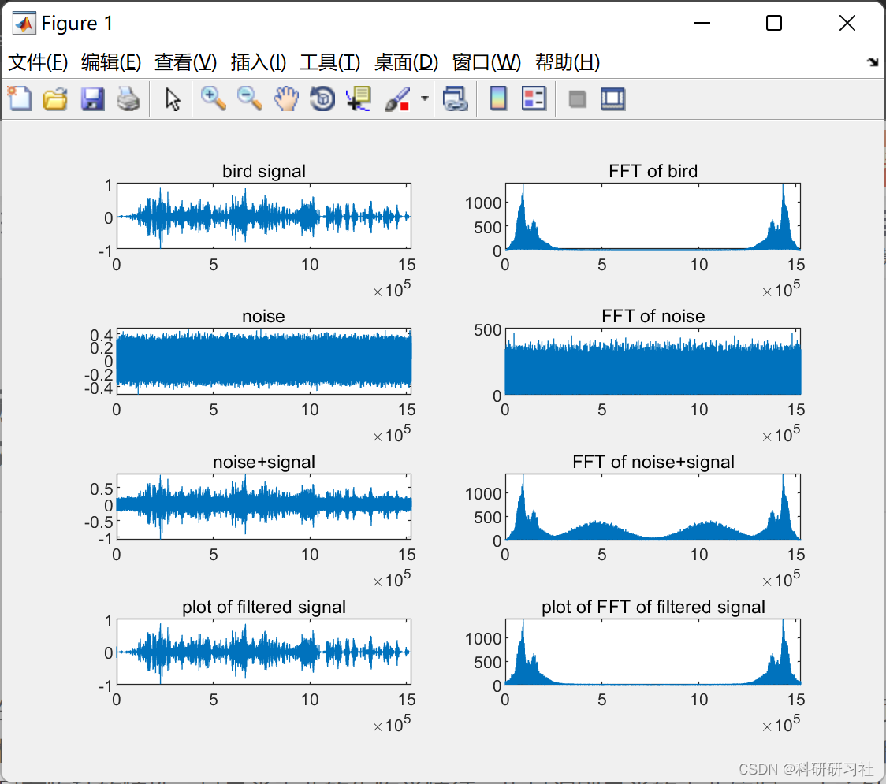
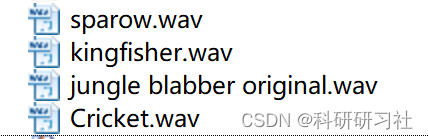

# [Speech Recognition]Identify the corresponding bird species in noisy bird vocal signals after eliminating noise based on LMS algorithm (Matlab code implementation)

​  
1. Overview
2. Running Results Editing
Voice:
Editor
3. Matlab code: This article only displays a part of the code, the full code can be found in:
Identify the corresponding bird species from noisy bird vocal signals based on LMS algorithm (Matlab code implementation)
figure\nsubplot(4,2,1)\nplot(signal1(:,1))      % plot bird signal\ntitle('bird signal')\n\ndata_fft = fft(signal1);\nsubplot(4,2,2)               % plot of FFT of bird signal\nplot(abs(data_fft(:,1)))\ntitle('FFT of bird')\n  
​  

## Images

<!-- PAYMENT_BLOCK -->

## Get this dataset

- Payment link (Stripe): [Buy now](https://buy.stripe.com/3cs8yP7sY87d0vu9AB)
- Payment QR code: 

<!-- /PAYMENT_BLOCK -->
